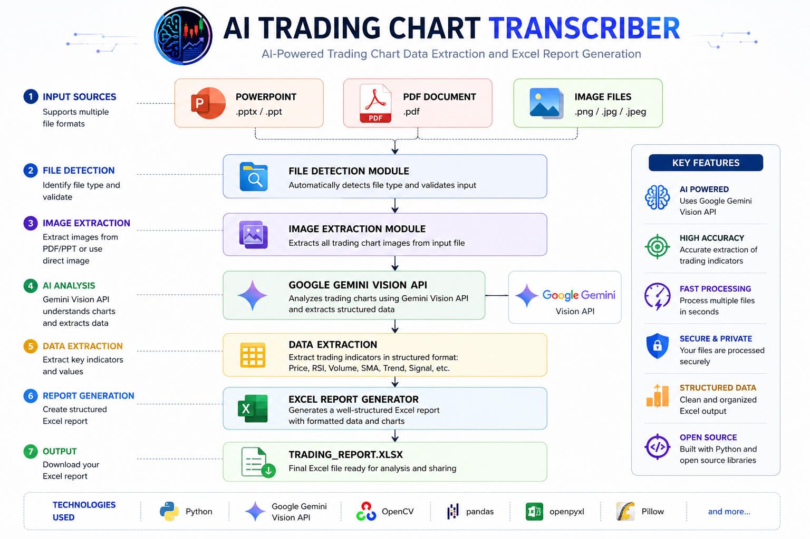

# AI Trading Chart Transcriber

<p align="center">
  
</p>


<h1 align="center">AI Trading Chart Transcriber</h1>

<p align="center">
AI-powered Trading Chart Analysis using Google Gemini Vision API
</p>

> AI-powered Trading Chart Transcriber built with **Python** and
> **Google Gemini Vision API** to automatically extract trading
> indicators from **PowerPoint, PDF, and Images** into a structured
> Excel report.


------------------------------------------------------------------------

## Overview

AI Trading Chart Transcriber is an automation tool that analyzes trading
chart screenshots, PDF files and PowerPoint presentations using **Google
Gemini Vision API**. Instead of OCR, it uses AI Vision to understand the
chart and extract structured trading information.

------------------------------------------------------------------------

## Features

-   Supports PPT / PPTX
-   Supports PDF
-   Supports PNG / JPG / JPEG
-   Google Gemini Vision API
-   AI Vision based analysis (Not OCR)
-   Automatic Excel report generation
-   Batch processing
-   Modular Python architecture

------------------------------------------------------------------------

## Supported Input

  Format   Supported
  -------- -----------
  PPT      ✅
  PPTX     ✅
  PDF      ✅
  PNG      ✅
  JPG      ✅
  JPEG     ✅

------------------------------------------------------------------------

## Extracted Fields

-   Price
-   RSI (14D)
-   Relation to 20 SMA
-   Volume Analysis
-   RSI
-   BB Status

------------------------------------------------------------------------

## Project Structure

``` text
AI-Trading-Chart-Transcriber/
│
├── input/
├── images/
├── output/
├── prompts/
├── logs/
├── ai_analyzer.py
├── config.py
├── excel_writer.py
├── extract_pdf.py
├── extract_ppt.py
├── logger.py
├── main.py
├── utils.py
├── requirements.txt
└── README.md
```

## 🏗️ System Architecture



------------------------------------------------------------------------

## Installation

``` bash
git clone https://github.com/Adityaraj8118/AI-Trading-Chart-Transcriber.git
cd AI-Trading-Chart-Transcriber
pip install -r requirements.txt
```

------------------------------------------------------------------------

## Usage

1.  Place your files inside the `input` folder.
2.  Run:

``` bash
python main.py
```

3.  The generated Excel report will be available in the `output` folder.

------------------------------------------------------------------------

## Technologies

-   Python 3.11
-   Google Gemini Vision API
-   OpenPyXL
-   Pillow
-   python-pptx
-   PyMuPDF
-   python-dotenv

------------------------------------------------------------------------

## Version Roadmap

### Version 1

-   AI transcription
-   Excel export
-   PPT/PDF/Image support

### Version 2 (In Progress)

- Multi-image batch processing
- Enhanced AI prompt engineering
- Improved chart detection accuracy
- Advanced Excel formatting
- Trading signal confidence score
- Performance optimization

-------------------------------------------------------------------------

## Author

**Aditya Raj Gupta**

GitHub: [Aditya Raj Gupta](https://github.com/Adityaraj8118)

Project Repository: https://github.com/Adityaraj8118/AI-Trading-Chart-Transcriber

------------------------------------------------------------------------

If you found this project useful, consider giving it a ⭐ on GitHub.